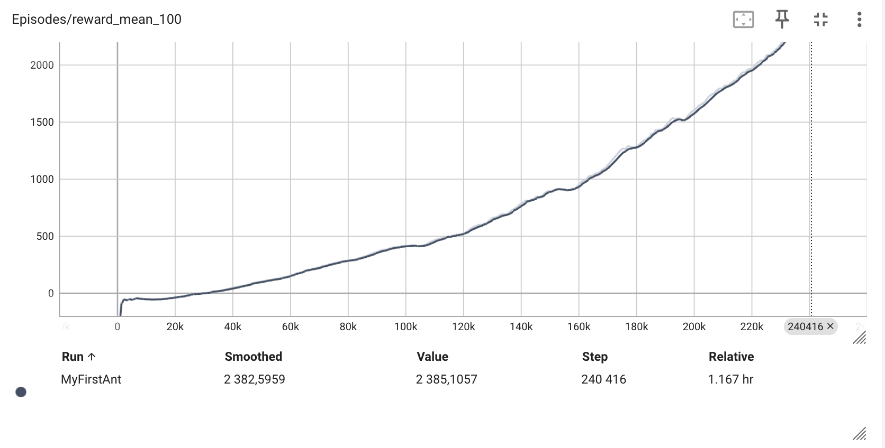
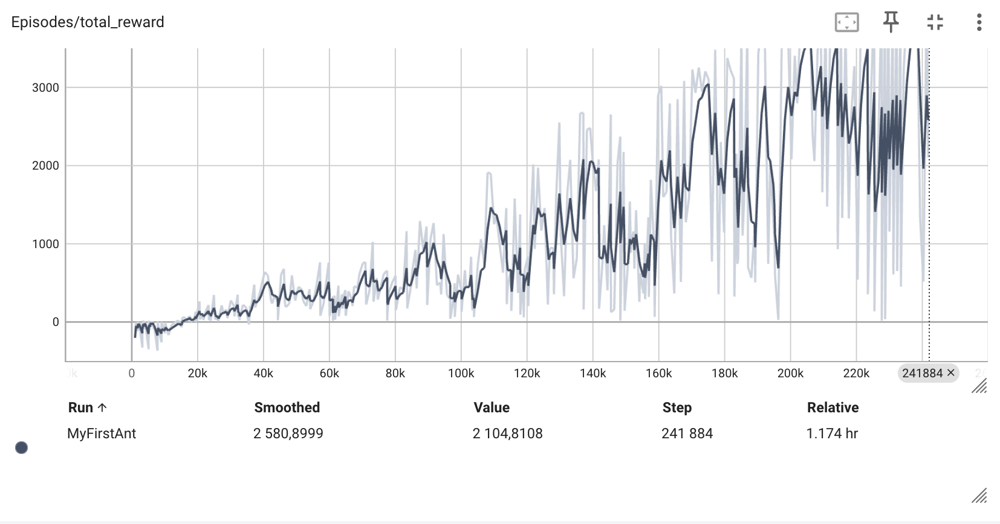

# Soft Actor-Critic for Continuous Control

University coursework implementation of **Soft Actor-Critic (SAC)** in PyTorch, trained on Gymnasium's MuJoCo **Ant-v5** continuous-control environment. The goal is to learn a stochastic policy that moves the quadruped. This implements an established algorithm; it does not propose a new RL method.

## Method and implementation

SAC is an off-policy, maximum-entropy actor-critic method. The notebook implements a tanh-squashed Gaussian policy with reparameterized sampling and log-density correction, two 256-unit MLP Q-networks, replay buffer, target Q-networks, Bellman targets, actor/critic optimization, gradient clipping and Polyak target updates. Ant-v5 supplies a 27-dimensional observation and eight bounded continuous actions with `include_cfrc_ext_in_observation=False`.

The original submitted notebook is preserved byte-for-byte in [`original/rl_hw5_final(1).ipynb`](original/rl_hw5_final(1).ipynb), including saved outputs. It contains instructor prose, setup and test scaffolding; completed model, buffer, loss and training cells are the student's coursework implementation. Exact line-by-line authorship cannot be proved from the notebook. The revised [`sac_ant.ipynb`](sac_ant.ipynb) retains the notebook structure, clears old outputs and makes a focused correction: its actor loss uses `min(Q1, Q2)` instead of only `Q1`. The local [`logger.py`](logger.py) replaces the downloaded course logger so the revised notebook can run from this directory. The correction **has not been retrained**. The score below belongs exclusively to the original implementation.

| Setting | Original run |
| --- | ---: |
| Discount `gamma` | 0.99 |
| Replay capacity | 100,000 |
| Random warm-up | 5,000 transitions |
| Batch size | 128 |
| Actor and critic learning rates | 3e-4 |
| Target update `tau` | 0.005 |
| Gradient norm cap | 10 |
| Entropy temperature `alpha` | 0.1, fixed |
| Actor update | Every gradient step |
| Seed | 42, set before training in original run |

The training loop collects one environment step and performs one critic/actor update per iteration after warm-up. The original notebook reports approximately 236,000 iterations on a Colab T4 in 1 h 11 min; its saved TensorBoard screenshots extend to roughly 242,000 environment steps, so the exact step count at evaluation is uncertain. Its saved evaluation prints **mean episodic return 1945.2007 over 20 episodes**, with stochastic actions and at most 1,000 steps per episode. No weights or raw TensorBoard event files were included, so that result cannot be independently recomputed from the submission. The saved screenshots are available below; they are from the original run.




## Reproduce

Use Python 3.10-3.12 with MuJoCo-compatible system libraries. From this repository:

```bash
python -m venv .venv
source .venv/bin/activate
python -m pip install -r requirements.txt
jupyter notebook sac_ant.ipynb
```

Run the cells in order. The original loop has a ceiling of 1,000,000 iterations and may require a GPU and substantial time; interrupt after the desired training budget before running evaluation. `tensorboard --logdir logs` displays new run logs. The notebook does not include a pretrained checkpoint. MuJoCo rendering and video capture require a suitable display or headless rendering setup. A short structural check can be run with `python -m py_compile logger.py`; full training was not rerun as part of packaging.

## Sources and limitations

- [Haarnoja et al., Soft Actor-Critic: Off-Policy Maximum Entropy Deep Reinforcement Learning with a Stochastic Actor (2018)](https://arxiv.org/abs/1801.01290)
- [OpenAI Spinning Up: SAC](https://spinningup.openai.com/en/latest/algorithms/sac.html)
- [Yandex Data School Practical RL course](https://github.com/yandexdataschool/Practical_RL), source of assignment scaffolding and the original external logger.

The course's rules for publishing homework code should be confirmed before making the repository public. No training dataset, checkpoints, CV or contact details are included.
